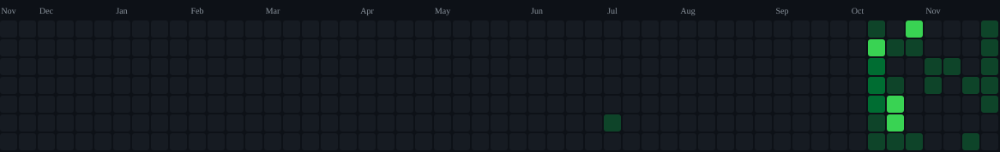

 
 
 
 
 
 
 
 
 
 
 
 
 
 
 
 
 
 
 
 
 
 
 
 
 
 
 
 
 
 
 
 
 
 
 
 
 
 
 

| Project | Stack | Link |
| :--- | :--- | :--- |
| **The Ultimate JARVIS** | Kotlin • Gemini AI • Android SDK | [View repo →](https://github.com/sukantcodes/The-Ultimate-Jarvis.apk) |
| **MovieBox** | Jetpack Compose • ExoPlayer • Room | [View repo →](https://github.com/sukantcodes/Moviebox-sukant) |
| **My Voice Assistant** | Kotlin • Android | [View repo →](https://github.com/sukantcodes/My-voice-assistant.Apk) |
| **Clozed Code** | Kotlin | [View repo →](https://github.com/sukantcodes/Clozed-code-) |

 
 
 
 
 
 
 
 
 
 
 
 
 
 
 
 

