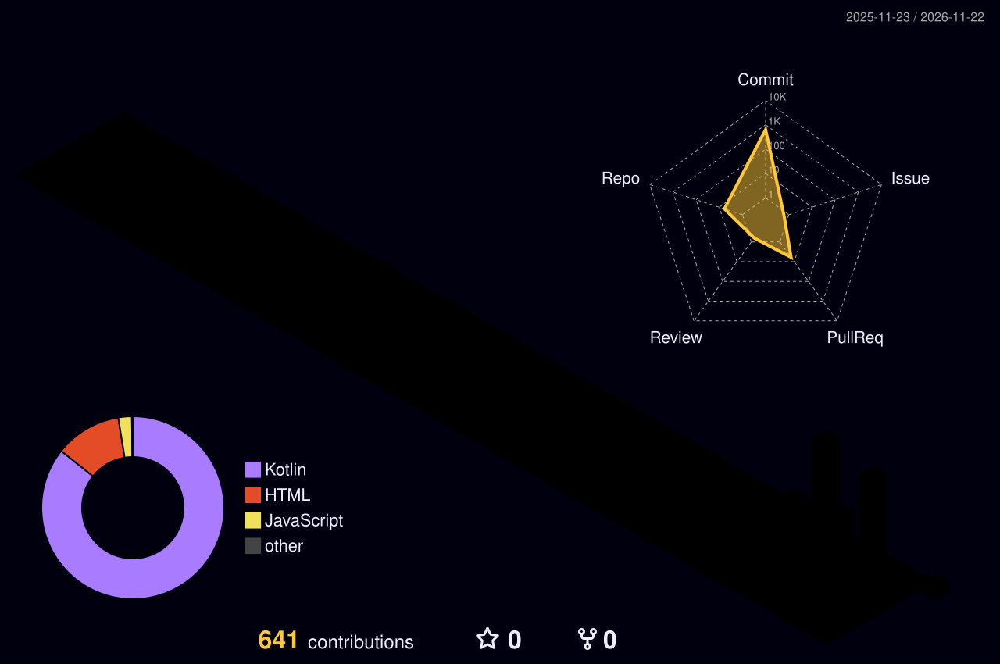
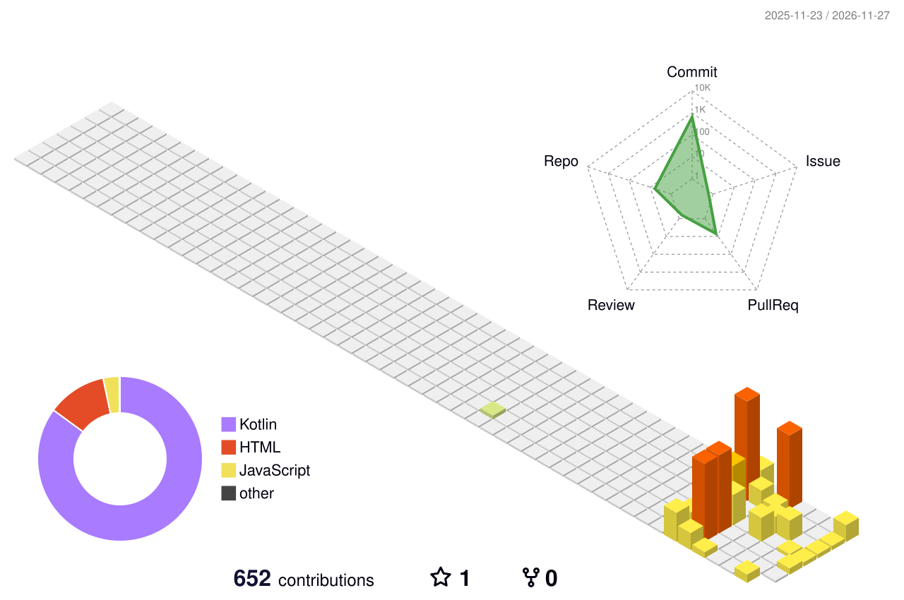
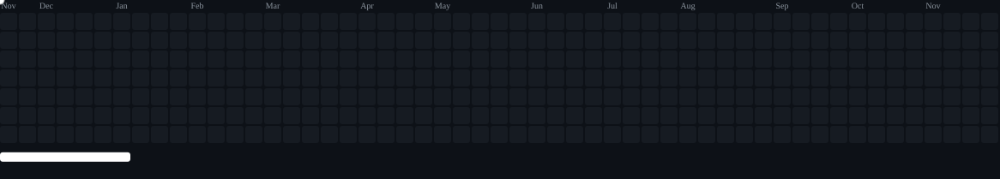

<table>
<tr>
<td width="50%" align="center"></td>
<td width="50%" align="center"></td>
</tr>
<tr>
<td width="50%" align="center"></td>
<td width="50%" align="center"></td>
</tr>
<tr>
<td width="50%" align="center"></td>
<td width="50%" align="center"></td>
</tr>
<tr>
<td width="50%" align="center"></td>
<td width="50%" align="center"></td>
</tr>
<tr>
<td width="50%" align="center"></td>
<td width="50%" align="center"></td>
</tr>
<tr>
<td width="50%" align="center"></td>
<td width="50%" align="center"></td>
</tr>
<tr>
<td width="50%" align="center"></td>
<td width="50%" align="center"></td>
</tr>
<tr>
<td width="50%" align="center"></td>
<td width="50%" align="center"></td>
</tr>
<tr>
<td width="50%" align="center"></td>
<td width="50%" align="center"></td>
</tr>
<tr>
<td width="50%" align="center"></td>
<td width="50%" align="center"></td>
</tr>
</table>

### 🚀 Production Projects

| Project | Stack | Link |
| :--- | :--- | :--- |
| **The Ultimate JARVIS** | Kotlin • Gemini AI • Android SDK | [View repo →](https://github.com/sukantcodes/The-Ultimate-Jarvis.apk) |
| **MovieBox** | Jetpack Compose • ExoPlayer • Room | [View repo →](https://github.com/sukantcodes/Moviebox-sukant) |
| **My Voice Assistant** | Kotlin • Android | [View repo →](https://github.com/sukantcodes/My-voice-assistant.Apk) |
| **Clozed Code** | Kotlin | [View repo →](https://github.com/sukantcodes/Clozed-code-) |

### 🧊 3D Contribution Skyline

### 🕹️ Arcade Mode

<picture>
  <source media="(prefers-color-scheme: dark)" srcset="https://raw.githubusercontent.com/sukantcodes/sukantcodes/output/pacman-contribution-graph-dark.svg">
  <source media="(prefers-color-scheme: light)" srcset="https://raw.githubusercontent.com/sukantcodes/sukantcodes/output/pacman-contribution-graph.svg">
  
</picture>

<picture>
  <source media="(prefers-color-scheme: dark)" srcset="https://raw.githubusercontent.com/sukantcodes/sukantcodes/output/breakout-contribution-graph-dark.svg">
  <source media="(prefers-color-scheme: light)" srcset="https://raw.githubusercontent.com/sukantcodes/sukantcodes/output/breakout-contribution-graph.svg">
  
</picture>

<picture>
  <source media="(prefers-color-scheme: dark)" srcset="https://raw.githubusercontent.com/sukantcodes/sukantcodes/output/galaga-contribution-graph-dark.svg">
  <source media="(prefers-color-scheme: light)" srcset="https://raw.githubusercontent.com/sukantcodes/sukantcodes/output/galaga-contribution-graph.svg">
  
</picture>

<picture>
  <source media="(prefers-color-scheme: dark)" srcset="https://raw.githubusercontent.com/sukantcodes/sukantcodes/output/tetris-contribution-graph-dark.svg">
  <source media="(prefers-color-scheme: light)" srcset="https://raw.githubusercontent.com/sukantcodes/sukantcodes/output/tetris-contribution-graph.svg">
  
</picture>

### 🐍 Contribution Snake

<picture>
  <source media="(prefers-color-scheme: dark)" srcset="https://raw.githubusercontent.com/sukantcodes/sukantcodes/output/github-snake-dark.svg">
  
</picture>

